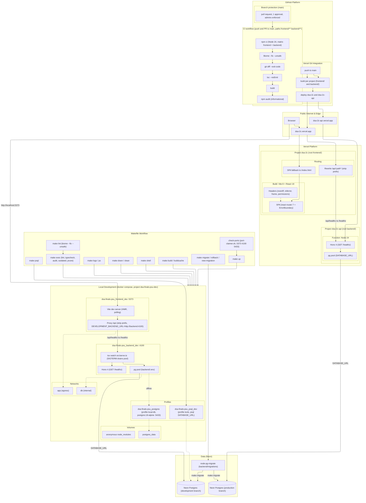

# dsa-finals-psu

## Setup on Windows

Double-click `scripts\setup.cmd`, or run it from a terminal:

```bat
scripts\setup.cmd
```

It installs Node LTS, Git, VS Code and GitHub Desktop through winget, refreshes PATH, and prints the versions with `SETUP OK`. Running it again is safe.

If winget is missing, install these by hand and reopen the terminal:

| Tool           | Source                        |
| -------------- | ----------------------------- |
| Node LTS       | https://nodejs.org            |
| Git            | https://git-scm.com           |
| VS Code        | https://code.visualstudio.com |
| GitHub Desktop | https://desktop.github.com    |

Frontend only, no database or backend:

```bat
cd frontend
npm ci
npm run dev
```

Then open http://localhost:5373.

## Host

Backend, in `backend/`:

```sh
npm ci
npm run dev
```

`backend/.env` holds `DATABASE_URL` and `.envrc` exports it into the shell. Without direnv, pass it inline: `DATABASE_URL=... npm run dev`.

Frontend, in `frontend/`:

```sh
npm ci
npm run dev
```

`flake.nix` supplies Node 24 and `playwright-mcp` to `nix develop` and direnv, and `.envrc` exports `.env` and `backend/.env` into that shell.

## Docker and Makefile

```sh
cp .env.example .env
cp backend/.env.example backend/.env
make build
make up
```

`make up` refuses to start until `DATABASE_URL` in `backend/.env` points at the dev branch.

## Deploy

Two Vercel projects build from this repo: `dsa-2c` from `frontend/` and `dsa-2c-api` from `backend/`. The site is https://dsa-2c.vercel.app, and `/api/*` reaches the API through the rewrite in `frontend/vercel.json`, so the browser only uses one origin. The API project holds `DATABASE_URL` for the production branch.

Renaming a project does not move its `*.vercel.app` domain. Add the new domain to the project and update the rewrite in the same change.

## Commands

| Command                          | Does                                                  |
| -------------------------------- | ----------------------------------------------------- |
| `make build`                     | build dev images                                      |
| `make up`                        | free ports, start the dev stack                       |
| `make down` / `make clean`       | stop, stop and delete the dev volume                  |
| `make logs` / `make ps`          | follow logs, list containers                          |
| `make exec`                      | Biome, tsc, audit and outdated in both dev containers |
| `make lint`                      | Biome fix in both dev containers                      |
| `make shell` / `make psql`       | shell in the backend, psql into `DATABASE_URL`        |
| `make migrate` / `make rollback` | node-pg-migrate up / down                             |
| `make new-migration name=x`      | create a migration file                               |
| `make check-ports`               | free 5373/4100/5433 from other compose projects       |

## Architecture



## Decisions

| Decision                                        | Why                                                                                                                                                                                 |
| ----------------------------------------------- | ----------------------------------------------------------------------------------------------------------------------------------------------------------------------------------- |
| Javascript/Typescript                           | Alot simpler to integrate and connect with languages intertwined, making the architecture and code alot easier to understand, develop, and learn.                                   |
| Hono over Express                               | Web-standard handlers and a typed context. Express as alternative as the reference for auth and middleware once routes exist.                                                       |
| Plain Vite 8 over Vite+                         | Vite+ bundles Vite, Vitest, Oxlint, Oxfmt and turbo behind a global installer and would replace Biome. Two services do not need that consolidation.                                 |
| No Tailwind                                     | No UI design yet. Plain CSS for lessen complexity with separation of concerns .                                                                                                     |
| No test runner                                  | Lowered-tier app: a test earns its place when the failure it catches costs more than the test. CI still gates lint, format, typecheck and build, and reports audit.                   |
| node-pg-migrate                                 | TypeScript runner with up and down in one file, no extra service. The migrations directory is empty, so nothing applies yet.                                                        |
| Neon Postgres, `production` and `development` branches, local container behind a profile | No local Postgres to run or version. Dev and prod are Neon branches, so a clone only needs a connection string.                                                                     |
| Vercel deploys, no CD workflow                  | Vercel builds and deploys on push from its git integration, so GitHub only runs CI. Compose stays for local and host runs.                                                          |
| Two Vercel projects, `/api` proxied             | Each service installs only its own dependencies, so no package is declared twice. One origin for the browser, no CORS to configure.                                                 |
| No prod Docker images                           | Vercel builds from source, so the images and their Trivy scan guarded nothing. Compose runs the dev targets only.                                                                   |
| Hono entry at `backend/src/index.ts`            | Vercel's Hono preset only looks for `app`, `index` or `server` at the project root or under `src`.                                                                                 |
| No `types` in the backend tsconfig              | Vercel compiles the function where `@types/node` is not installed, so pinning it fails the build with TS2688.                                                                      |
| Security headers in `frontend/vercel.json`      | Vercel sent only HSTS. The nginx headers never reached the live site, so the app's headers are config.                                                                              |
